<p align="center"></p>

<p align="center">
  
  
  
  
  
</p>

<p align="center"><b>Rediscover the games the world grew up playing.</b><br/>
Vexta is a web platform for exploring traditional games from different cultures. Browse them by genre or on a world map, learn the rules and cultural background, watch them being played, bookmark favourites and get recommendations.</p>

###  Stage select

| | | Stage | |
|---|---|---|---|
|  | 01 | [Story mode](#story-mode) | About Vexta |
|  | 02 | [Press start](#press-start) | Quick start |
|  | 03 | [Power-ups](#power-ups) | Features |
|  | 04 | [Game map](#game-map) | Architecture and project layout |
|  | 05 | [Save data](#save-data) | Data models |
|  | 06 | [Cheat codes](#cheat-codes) | API reference |
|  | 07 | [Level select](#level-select) | Frontend routes |
|  | 08 | [House rules](#house-rules) | Coding standards |
|  | 09 | [Boss fights](#boss-fights) | Known issues and security |
|  | 10 | [Next level](#next-level) | Roadmap |
|  | 11 | [Credits](#credits) | Team and acknowledgements |

<br/>

<a id="story-mode"></a>


Before video games, every culture had its own: board games scratched into stone, hand games, throwing games, horseback sports, games played in a circle in the street. Many are fading as fewer people learn them.

**Vexta** collects these games in one place. Each one comes with its origin country, rules, number of players, age group, cultural context, and often a video of it being played. You can find games by genre, search them by name, or spin a world map and pick a country.

Vexta was built for **CMPS 271, Software Engineering**, at the **American University of Beirut** in Spring 2025.

### How a player uses it

1. **Sign up** and pick the genres you like.
2. **Explore** the home page carousels, the full catalogue, or the world map.
3. **Open a game** to read how it's played, where it comes from, and watch a video.
4. **Bookmark** favourites and get **recommendations** based on your genres.
5. **Add friends** and browse their public profiles and bookmarks.

<br/>

<a id="press-start"></a>


### Requirements

| Tool | Version |
|---|---|
| Node.js | 18 or newer |
| npm | comes with Node.js |
| MongoDB | a local server or a MongoDB Atlas cluster |

### Player 1: the backend

```bash
cd Backend
npm install
```

Create `Backend/.env`:

```env
MONGO_URI=mongodb+srv://<user>:<password>@<cluster>/<database>
JWT_SECRET=<a long random string>
```

Then start the API:

```bash
npm run dev      # with auto-reload (nodemon)
# or
npm start
```

The API runs at **http://localhost:5001**. Run it from inside `Backend/`, because uploaded profile pictures are saved to `Backend/uploads/`.

### Player 2: the frontend

```bash
cd front-end
npm install
```

Create `front-end/.env`:

```env
VITE_BACKEND_URL=http://localhost:5001
```

Then start the app:

```bash
npm run dev      # http://localhost:5173
```

### Frontend scripts

| Command | What it does |
|---|---|
| `npm run dev` | Start the Vite dev server with hot reload |
| `npm run build` | Type-check and build to `front-end/build/` |
| `npm run preview` | Serve the production build locally |
| `npm run lint` | Run ESLint |

### Load the catalogue

The database starts empty. Add games through the **Add Game** page in the app, or by sending `POST /api/games` (see [Cheat codes](#cheat-codes)).

To show a game in the home page hero slider, save its image as `front-end/public/images/<Game Title>.png`, then call:

```bash
curl http://localhost:5001/api/games/update-slider-images
```

<br/>

<a id="power-ups"></a>


| | Power-up | What it does |
|---|---|---|
|  | **Accounts** | Sign up and log in. Passwords are hashed with bcrypt, and sessions use JWTs that last 1 day |
|  | **World map** | A Leaflet map with a marker per country or region. Click one to see its games |
|  | **Catalogue and filters** | Search by title, filter by genre and origin country, with paging |
|  | **Game pages** | Rating, genre, origin, player count, full description and cultural context |
|  | **Videos** | YouTube videos and embedded content shown on the game page |
|  | **Recommendations** | Games matching the genres you picked, in a swipeable carousel |
|  | **Bookmarks** | Save games and see them on your profile |
|  | **Friends** | Find players, add or remove friends, and view their public profiles |
|  | **Profile pictures** | Upload your own avatar |
|  | **Add Game** | A form for adding new games to the catalogue |

### Genres

`Board Game` · `Physical Game` · `Team Sport` · `Horseback Sport` · `Outdoor Game` · `Hand Game` · `Throwing Game` · `Toy Game` · `Dexterity Game` · `Strength Game` · `Coordination Game` · `Jumping Game` · `Circle Game` · `Elimination Game` · `Collectible Game`

<br/>

<a id="game-map"></a>


### Architecture

```
 ┌──────────────────────────┐   HTTP + JSON    ┌──────────────────────────┐   Mongoose   ┌───────────┐
 │  front-end/              │ ───────────────▶ │  Backend/                │ ───────────▶ │  MongoDB  │
 │  React 19 + TypeScript   │                  │  Express on :5001        │              │           │
 │  Vite on :5173           │ ◀─────────────── │  JWT · bcrypt · Multer   │ ◀─────────── │  users    │
 │  Leaflet · Swiper        │                  │  /uploads (static files) │              │  games    │
 └──────────────────────────┘                  └──────────────────────────┘              └───────────┘
```

- The frontend reads the API address from `VITE_BACKEND_URL` (in `src/config.tsx`).
- After login, the browser keeps `token` and `userId` in `localStorage`.
- Protected endpoints read the JWT from a `token: Bearer <jwt>` request header.

### Project layout

```
Cmps-271-Vexta/
├── Backend/                      ▸ Express API
│   ├── index.js                  app setup, routes, port 5001
│   ├── server.js                 MongoDB connection
│   ├── controllers/              auth and user logic
│   ├── middlewares/verifyToken.js  JWT check
│   ├── models/                   User and Games schemas
│   ├── routes/                   auth, users, games, recommendations
│   └── uploads/                  profile pictures
│
├── front-end/                    ▸ React app (the current frontend)
│   ├── public/images/            game artwork
│   └── src/
│       ├── App.tsx               routes
│       ├── config.tsx            API base URL
│       ├── Pages/                Home, AllGames, Map, CountryGames, About
│       ├── components/           header, hero slider, filters, game details,
│       │                         login, signup, friends, profile, recommendations…
│       └── data/                 genres and shared types
│
└── src/, public/, *.html         ▸ early prototype, kept for reference
```

> [!NOTE]
> The repository root also contains the project's first prototype (Create React App files, `index.html`, `login.html`). The live app is in `front-end/`.

### Tech stack

| Layer | Tools |
|---|---|
| Frontend | React 19, TypeScript, Vite, React Router 6, Bootstrap 5, styled-components, Swiper, React Leaflet, Lucide and React Icons, Axios |
| Backend | Node.js, Express, Mongoose, jsonwebtoken, bcryptjs, Multer, validator, cors, dotenv |
| Database | MongoDB |

<br/>

<a id="save-data"></a>


### `User`

| Field | Type | Notes |
|---|---|---|
| `email` | String | required, unique |
| `username` | String | required, unique |
| `password` | String | bcrypt hash |
| `friends` | ObjectId[] → `User` | |
| `preferences` | String[] | favourite genres, used for recommendations |
| `profilePicture` | String | defaults to `uploads/default.jpg` |
| `bookmarkedGames` | ObjectId[] → `Games` | |

### `Games`

| Field | Type | Required |
|---|---|---|
| `title` | String | yes |
| `description` | String | yes, short summary |
| `fullDescription` | String | yes, rules and details |
| `category` | String | yes, one of the [genres](#genres) |
| `OriginCountry` | String | yes |
| `numberOfPlayers` | Number | yes, minimum players |
| `ageGroup` | String | yes |
| `overlayImage` | String | yes, card image URL |
| `culture`, `culturalContext` | String | |
| `averageRating`, `ratingCount` | Number | |
| `estimatedDuration` | String | |
| `sliderImage` | String | hero slider image path |
| `Video` | String | YouTube URL |
| `Embedded` | String | URL shown in an embedded frame |
| `createdAt`, `updatedAt` | Date | set automatically |

<br/>

<a id="cheat-codes"></a>


Base URL: `http://localhost:5001/api`. All bodies are JSON unless noted.

### Auth

| Method | Endpoint | Body | Returns |
|---|---|---|---|
| `POST` | `/auth/signup` | `email`, `username`, `password` | `token`, `user` |
| `POST` | `/auth/login` | `email`, `password` | `token`, `user` |

Sign-up accepts `@gmail.com`, `@hotmail.com` and `@mail.aub.edu` addresses.

### Games

| Method | Endpoint | Description |
|---|---|---|
| `GET` | `/games` | All games |
| `GET` | `/games/AllGames?search=&page=1&limit=6` | Search by title with paging. Returns `games`, `currentPage`, `totalPages` |
| `GET` | `/games/title/:title` | One game by exact title |
| `GET` | `/games/:id` | One game by ID |
| `POST` | `/games` | Add a game (see [`Games`](#games)) |
| `GET` | `/games/update-slider-images` | Link games to `front-end/public/images/<Title>.png` |

### Users

| Method | Endpoint | Body | Description |
|---|---|---|---|
| `GET` | `/users` | | All users (`_id`, `username`) |
| `GET` | `/users/:id/friends` | | A user's friends |
| `POST` | `/users/:userId/add-friend` | `friendId` | Add a friend |
| `POST` | `/users/:userId/remove-friend` | `friendId` | Remove a friend |
| `POST` | `/users/preferences` | `userId`, `categories` | Save favourite genres |
| `POST` | `/users/:id/upload-profile-picture` | form-data `profilePicture` | Upload an avatar |
| `POST` | `/users/:userId/bookmark` | `gameId` | Toggle a bookmark |
| `GET` | `/users/:userId/bookmarks` | | A user's bookmarked games |
| `GET` | `/users/:userId/profile` | | Public profile: `username`, `bookmarks` |

### Recommendations

| Method | Endpoint | Header | Description |
|---|---|---|---|
| `GET` | `/recommendations/:userId` | `token: Bearer <jwt>` | Games in the user's favourite genres. The token must belong to `:userId` |

### Static files

`GET /uploads/<file>` serves uploaded profile pictures.

<br/>

<a id="level-select"></a>


| Path | Screen |
|---|---|
| `/` | Home: hero slider, culture section, recommendations, game catalogue |
| `/login` · `/signup` | Log in and sign up |
| `/choose-categories` | Pick favourite genres |
| `/All-Games` | Full catalogue with search and paging |
| `/games/title/:title` | Game details, videos and embeds |
| `/Map` | World map |
| `/country/:countryName` | Games from one country |
| `/bookmarked` | Your bookmarks |
| `/friends` · `/my-friends` | Find players and see your friends |
| `/profile/:userId` | A player's public profile |
| `/change-profile-picture` | Upload an avatar |
| `/enter-pin` → `/add-game` | Add a game to the catalogue |
| `/About` | About the project and team |

<br/>

<a id="house-rules"></a>


These rules apply to every change. A pull request that breaks one should say why.

### General

- **New frontend code is TypeScript** in `front-end/src`. Don't add to the root prototype.
- Run `npm run lint` and `npm run build` in `front-end/` before every push. Both must pass.
- Keep secrets out of git. `.env` files are local only; share the variable **names**, never values.
- Remove `console.log` debugging before committing. Never log tokens, passwords or user data.

### Naming

| Item | Convention | Example |
|---|---|---|
| React components and their files | `PascalCase` | `GameDetail.tsx`, `FriendSearch` |
| Component folders | `camelCase`, with an `index.tsx` entry | `heroSection/`, `filterSection/` |
| Hooks, variables, functions | `camelCase` | `filteredGames`, `toggleBookmark` |
| Constants | `camelCase` exports in `src/data/consts` | `genres` |
| Interfaces | `PascalCase`, in `src/data/interfaces` | `Game` |
| API routes | lowercase, hyphenated | `/add-friend`, `/upload-profile-picture` |
| Mongoose fields (new) | `camelCase` | `estimatedDuration` |

### Frontend

- Function components with hooks only.
- Type props, state and API responses. Avoid `any`.
- Read the API address from `API_BASE_URL` in `src/config.tsx`. Never hard-code `localhost`.
- Every API call handles **loading** and **error** states, and shows the user what went wrong.
- Keep shared types in `src/data/interfaces` and shared constants in `src/data/consts`.
- Put each component's CSS next to it, or use styled-components. Don't add global styles for one screen.

### Backend

- Keep the layers separate: **routes** declare endpoints, **controllers** hold the logic, **models** define schemas.
- Wrap every handler in `try/catch`. Respond with a clear status code and a JSON `message`.

| Status | When |
|---|---|
| `200` / `201` | Success / created |
| `400` | Invalid input |
| `401` | No token |
| `403` | Token doesn't allow this action |
| `404` | Resource not found |
| `500` | Unexpected server error. Never send stack traces or raw error objects to the client |

- Validate request bodies before touching the database (the `validator` package is already installed).
- Any endpoint that changes a user's data must use `verifyToken` and check that `req.user.id` matches the target user.
- Never return password hashes. Select only the fields the client needs.

### Git workflow

- Branch from `main`: `feature/map-filters`, `fix/bookmark-toggle`.
- Commit messages are short and in the imperative mood: `Add country filter to map`.
- Open a pull request. A teammate reviews it before it's merged.

<br/>

<a id="boss-fights"></a>


Vexta was built as a course project. Before running it publicly, beat these bosses:

| Boss | Why it matters |
|---|---|
|  **Unprotected user and game endpoints** | Only `/recommendations` checks the JWT. Friend, bookmark, preference, upload and add-game endpoints should require a token and check ownership |
|  **Add Game access** | The Add Game page is gated by a PIN checked in the browser. Replace it with an admin role checked on the server |
|  **Upload limits** | Profile picture uploads have no file type or size limit |
|  **Search input** | The title search is used directly as a regular expression. Escape it first |
|  **Database startup** | If MongoDB can't connect, the error is logged and the API still starts without a database |
|  **Placeholder data** | The "Popularity" line on game pages is placeholder text |

If you find a security problem, please contact the maintainer privately through [his GitHub profile](https://github.com/tarek-kaadan) instead of opening a public issue.

<br/>

<a id="next-level"></a>


 done &nbsp;·&nbsp;  planned

| Status | Item |
|---|---|
|  | Accounts, genres and recommendations |
|  | Catalogue with search, filters and paging |
|  | World map and country pages |
|  | Bookmarks, friends and public profiles |
|  | Game videos and embeds |
|  | Protect all write endpoints with JWT and ownership checks |
|  | Server-side admin role for adding and editing games |
|  | Let players rate games |
|  | Seed script with the starter catalogue |
|  | Backend tests and CI |
|  | Move the backend port into `.env` |
|  | Remove the early prototype from the repo root |

<br/>

<a id="credits"></a>


<p align="center"><b>Built by</b></p>

| Player | |
|---|---|
| **Tarek Kaadan** | [@tarek-kaadan](https://github.com/tarek-kaadan) |
| **Hussein Marji** | |
| **Alfred Nahas** | |
| **Ali Saad** | |

With thanks to **Dr. Sari Al Lakkis**, course instructor for CMPS 271 at the American University of Beirut.

<p align="center"><sub>3D emoji from <a href="https://github.com/microsoft/fluentui-emoji">Microsoft Fluent Emoji</a> (MIT License)</sub></p>
<p align="center"><sub>GAME OVER? CONTINUE? ⬆⬆⬇⬇⬅➡⬅➡</sub></p>
